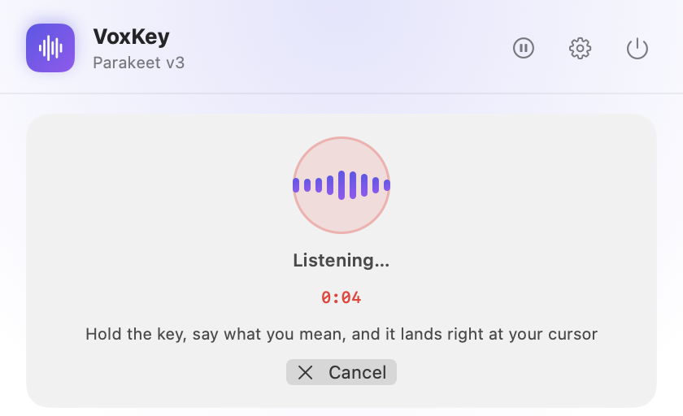

# VoxKey

[](https://github.com/georgecristea/VoxKey/actions/workflows/ci.yml)
[](https://github.com/georgecristea/VoxKey/releases/latest)

[](LICENSE)

**Push-to-talk dictation for macOS, transcribed on your Mac.** Hold a key, speak, let go: VoxKey
turns your voice into text and pastes it at the cursor, in any app. Your audio never leaves the
Mac.

<p align="center"></p>

## Features

- **Hold to talk.** Hold **Fn + Control** (or any shortcut you record in Settings), speak, release.
- **On-device speech recognition.** NVIDIA Parakeet on the Apple Neural Engine (via
  [FluidAudio](https://github.com/FluidInference/FluidAudio)), or OpenAI Whisper via
  [whisper.cpp](https://github.com/ggml-org/whisper.cpp) (Metal on Apple Silicon, CPU on Intel).
- **Live preview** of what you're saying while you hold the key (Apple Silicon), with three speed
  settings. Optionally **type as you speak**, so text appears in the target app while you talk.
- **Works in any app.** The text is pasted at the cursor, and your previous clipboard comes back a
  moment later. Optionally send Return after the text, handy for chat boxes and terminals.
- **Picks a model for your Mac.** First run recommends one based on your chip and preferred
  languages, with a guided setup for permissions and the download.
- **Language setting** for the multilingual models: English by default, auto-detect, or one of ten
  more languages.
- Pause from the menu bar, launch at login, an in-app dictation test box.

## Models

Models download on first use from Hugging Face into
`~/Library/Application Support/VoxKey/Models` (excluded from Time Machine).

| Model | Download | Languages | Engine |
|-------|----------|-----------|--------|
| Parakeet v3 (default) | ~700 MB | 25 European languages, incl. English | Neural Engine |
| Parakeet v2 | ~650 MB | English | Neural Engine |
| Parakeet Lite 110M | ~250 MB | English | Neural Engine |
| Whisper Large v3 | 3.1 GB | multilingual | whisper.cpp |
| Whisper Small | 466 MB | English | whisper.cpp |
| Whisper Base | 148 MB | English (keeps fillers, verbatim) | whisper.cpp |
| Whisper Tiny | 78 MB | English | whisper.cpp |

On Apple Silicon, a small streaming model (Parakeet Realtime EOU 120M) also downloads at launch to
power the live preview. Intel Macs default to Whisper Base and have no live preview.

## Install

### Download

Get **VoxKey.dmg** from the [latest release](https://github.com/georgecristea/VoxKey/releases/latest)
and drag VoxKey into Applications.

The app isn't notarized by Apple yet, so macOS blocks the first launch. Open it once with
**System Settings → Privacy & Security → Open Anyway**, or run:

```sh
xattr -dr com.apple.quarantine /Applications/VoxKey.app
```

### Build from source

Requires macOS 14 or newer and Xcode 15+ (or the Xcode command line tools). Apple Silicon is
recommended; Intel Macs work with the Whisper models.

```sh
git clone https://github.com/georgecristea/VoxKey.git
cd VoxKey
./scripts/install.sh   # universal release build → /Applications/VoxKey.app, then launches it
```

### Permissions

VoxKey asks for two permissions on first run:

- **Microphone**, to hear you while the hotkey is held.
- **Accessibility**, to see the global hotkey and to paste into the app you're using.

macOS ties the Accessibility grant to the app's signature. After installing a new build, if the
hotkey stops working, remove VoxKey from **System Settings → Privacy & Security → Accessibility**
and add it again.

## Privacy

- Audio is captured into memory while you hold the key, transcribed, and discarded. VoxKey saves no
  recordings, transcripts, or history.
- The only network traffic is model downloads from huggingface.co. No accounts, analytics, or
  crash reporting.
- The text passes through the clipboard for about a second while it is pasted, so a clipboard
  history app may record it.

Found a security problem? See [SECURITY.md](SECURITY.md).

## How it works

```
hotkey down ─► AVAudioEngine tap, 16 kHz mono in memory ─► live preview (Parakeet EOU, streaming)
hotkey up   ─► full buffer ─► selected model (Parakeet / whisper.cpp) ─► paste at cursor (⌘V), restore clipboard
```

```
Sources/VoxKey/
  App/       AppDelegate, AppState (capture lifecycle, permissions, models), AppSettings
  Services/  DictationStreamer, TranscriptionCoordinator, FluidAudioEngine, WhisperCppEngine,
             HardwareRecommender, PasteInjector, AppPaths
  Models/    SpeechModel (catalog), DictationLanguage
  UI/        StatusBarController, MainPopoverView, SettingsView, OnboardingWindowController, AboutView
```

The UI is built on [MacUtilityKit](https://github.com/georgecristea/MacUtilityKit), the shared
toolkit behind this app, [ClipVault](https://github.com/georgecristea/ClipVault) and
[Upkeep](https://github.com/georgecristea/upkeep).

## Development

```sh
swift build            # compile
swift run              # build and launch (dev only)
./scripts/install.sh   # package, install to /Applications, relaunch
.build/debug/VoxKey --demo --snapshot out.png   # render a sample popover to a PNG; starts nothing
```

Always test from `/Applications`. Packaging scripts: `scripts/package-app.sh` (app bundle with the
embedded whisper.framework), `scripts/make-dmg.sh`, `scripts/release.sh <tag>` (GitHub release), and
`scripts/notarize.sh` (Developer ID signing and notarization, needs an Apple Developer account).
[CLAUDE.md](CLAUDE.md) has the architecture notes, for humans and coding agents alike. See
[CONTRIBUTING.md](CONTRIBUTING.md).

## Acknowledgements

- [NVIDIA Parakeet](https://huggingface.co/nvidia/parakeet-tdt-0.6b-v3) speech models: TDT 0.6B v2/v3
  and TDT-CTC 110M under CC-BY-4.0; Realtime EOU 120M under the NVIDIA Open Model License. Core ML
  conversions by [FluidInference](https://huggingface.co/FluidInference).
- [FluidAudio](https://github.com/FluidInference/FluidAudio), Apache License 2.0.
- [whisper.cpp](https://github.com/ggml-org/whisper.cpp) and [OpenAI Whisper](https://github.com/openai/whisper)
  models, MIT License.

Models are downloaded by the app at runtime and are not part of this repository. See
[THIRD_PARTY_NOTICES.md](THIRD_PARTY_NOTICES.md).

## License

[MIT](LICENSE) © DeepDive Solna AB. Made by [George Cristea](https://github.com/georgecristea).
